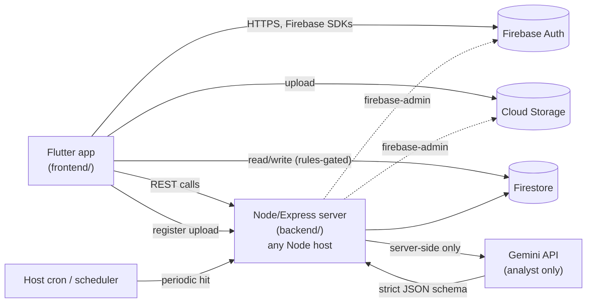

# Architecture

## 1. System shape



Two runtime surfaces:

- **frontend/** — Flutter, talks to Firebase Auth, Firestore, and Cloud Storage directly via the official SDKs for reads and simple writes, and talks to **backend/** over HTTPS for anything that needs server-side logic, validation, or the Gemini key.
- **backend/** — a **plain Node.js/Express server** (`app.listen`, no Cloud Functions) deployable to any Node host — Render, Railway, Fly.io, Vercel's Node runtime, a VPS, whatever's cheapest/easiest at the time. It talks to Firebase (Auth/Firestore/Storage) via the `firebase-admin` SDK using an explicitly-configured service account (there's no ambient GCP identity outside Cloud Functions — see `backend/src/config/firebaseAdmin.js`).

Firebase itself is still used for Auth, Firestore, and Storage — only the **compute** moved off Firebase. This matters for billing: Firestore/Auth/Storage usage stays within Firebase's own free-tier limits regardless of plan tier, and no Cloud Functions means no Blaze-plan requirement for compute at all.

There is no Cloud Functions Storage trigger anymore (that's GCP-proprietary and only available inside Cloud Functions). Instead: the Flutter client uploads a reference video to Storage directly, then calls a plain backend endpoint to register it (`status: queued`). **How the queue then gets processed is still open** — not decided yet, deliberately deferred until the backend host is chosen (see [ASSUMPTIONS_AND_DECISIONS.md](./ASSUMPTIONS_AND_DECISIONS.md)). The leading option, documented as the default plan but not locked in: a small **internal endpoint**, hit periodically by whatever scheduling feature the chosen host provides (a cron job, a scheduled GitHub Action, etc.), processing a batch of queued references each time it's invoked — this works even on hosts with short request timeouts. The alternative, viable only on a host that keeps a process alive (not pure-serverless), is a long-running worker that polls Firestore in a loop instead. See [TECHNICAL_DEEP_DIVE.md](./TECHNICAL_DEEP_DIVE.md) section 3 for the full trace of the cron-hit version.

## 2. The AI firewall, as code

This is the one architectural rule that is not negotiable (see README "The one rule"):

1. **No Gemini key in the client.** The key lives only in the backend host's environment config/secret manager. `frontend/` never imports a Gemini SDK and has no code path that could call it.
2. **Gemini is called from exactly one place:** `backend/src/services/geminiAnalysis.service.js`. No controller, repository, or route calls the Gemini SDK directly — everything funnels through this service.
3. **Structured output only.** Every Gemini call passes a `responseSchema` built from enums, numbers, booleans, and short string labels — see [FIRESTORE_SCHEMA.md](./FIRESTORE_SCHEMA.md) `references/{rid}.analysis`. There is no free-text field in that schema a script could leak out through.
4. **The writing room has zero AI dependencies.** `frontend/lib/features/writing_room/` does not depend on anything under `frontend/lib/features/library/data` that touches Gemini-origin fields except as **read-only reference display** — it never generates, rewrites, or autocompletes script text.
5. **Every script edit is attributed.** `scripts/{sid}/versions/{vid}` always carries `authorUid` and `createdAt`, written by the backend, never trusted from client-supplied fields — this is the data Human Ink is built from later.

## 3. Repo layout

```text
Foolscap/
  frontend/                  Flutter app
    lib/
      app/                   bootstrap, root widget, DI wiring
      core/                  theme, routing, network, storage, shared widgets, errors
      features/
        auth/
        workspaces/          Brand Bible lives here
        library/             capture, snapshots, transcripts, X-Ray, folders, search
        writing_room/        scripts, versions, timers, hook bench, overlap alarm
        expression_vault/
        pitch/
        guardrails/          linter + pillar heatmap UI (reads workspace Brand Bible)
        set_mode/            teleprompter + take log
        radar/                future, stub only
        human_ink/           future, stub only
        settings/
    assets/
    test/
  backend/                   plain Node.js/Express server, no Cloud Functions
    src/
      config/                env, firebase-admin init (explicit service account), gemini client init
      middleware/             auth, validation, rate limit, error handler, logging
      routes/                 thin route definitions, one file per domain
      controllers/            HTTP <-> service translation, no business logic
      services/               business logic, including the one Gemini call site
      repositories/           all Firestore/Storage access, no HTTP concerns
      validators/             request schemas (zod)
      utils/                  logger, response envelope, custom errors
    index.js                  app.listen — the whole process entry point
    test/
  docs/
  firebase.json              Firestore/Storage rules + indexes deploy only — no functions block
  firestore.rules
  firestore.indexes.json
  storage.rules
```

This mirrors [FLUTTER_FULL_STACK_PLAYBOOK.md](../FLUTTER_FULL_STACK_PLAYBOOK.md) section 3's "feature-first" frontend shape and section 2's backend layering exactly, with folder names `frontend`/`backend` instead of `app`/`functions` per project convention here. The layering held up unchanged across the Cloud-Functions-to-plain-server pivot (see [ASSUMPTIONS_AND_DECISIONS.md](./ASSUMPTIONS_AND_DECISIONS.md)) — routes/controllers/services/repositories don't know or care what process is hosting them.

## 4. Why feature-first on day one

The playbook says to start with the flat `controller/model/navigation/services/utils/views` shape and migrate to feature-first once screens start sharing state. Foolscap skips that step deliberately: README's own roadmap already names six substantial feature areas (Library, Room, Pitch, Guardrails, Radar, Set) plus Auth/Workspaces as a prerequisite — that threshold is crossed before a single screen is built, so starting flat would mean a guaranteed, costly migration. Logged in [ASSUMPTIONS_AND_DECISIONS.md](./ASSUMPTIONS_AND_DECISIONS.md).

## 5. Deployment topology

- **Firebase project** on the free **Spark** plan — Auth, Firestore, and Storage all work on Spark. Nothing in this architecture requires Blaze, because there are no Cloud Functions (see [ASSUMPTIONS_AND_DECISIONS.md](./ASSUMPTIONS_AND_DECISIONS.md)). Watch Storage/Firestore usage against Spark's free quotas as the app grows regardless.
- **Backend host**: any Node-capable free tier (Render, Railway, Fly.io, Vercel, etc.) — pick one that also offers a free scheduled-job feature, since the reference-analysis queue needs periodic invocation (see [TECHNICAL_DEEP_DIVE.md](./TECHNICAL_DEEP_DIVE.md) section 3).
- Three environments: `foolscap-dev`, `foolscap-staging`, `foolscap-prod` (or Firebase project aliases) — see [ENVIRONMENTS.md](./ENVIRONMENTS.md).
- Keep the backend host's region close to Firestore/Storage's region to avoid cross-region latency and egress cost.
- **Flutter builds: Android + iOS only.** Foolscap is a mobile app, full stop — no Flutter Web, no desktop target. This is a deliberate scope decision (see [ASSUMPTIONS_AND_DECISIONS.md](./ASSUMPTIONS_AND_DECISIONS.md)), not a temporary v1 limitation.
- The one surface that *looks* like it needs "web" — the Pitch public link a client opens with no app installed — is **not** solved with Flutter Web. It's a plain server-rendered HTML page served directly by the backend (see section 7 below). The Flutter app never ships a web build.

## 6. The one exception to "mobile only": the public Pitch page

The backend serves one small, unauthenticated, server-rendered HTML page (`GET /pitch/:token`) for the Pitch feature's public link (Phase 3). This is backend-rendered HTML (template literals or a minimal template engine — no SPA framework, no build step), not a Flutter artifact of any kind, and not a general-purpose "also build a web app" decision — it exists only because a brand/client reviewing a pitch cannot be assumed to have Foolscap installed. See [FEATURE_PLAN.md](./FEATURE_PLAN.md) Phase 3.1 and [TECHNICAL_DEEP_DIVE.md](./TECHNICAL_DEEP_DIVE.md) section 5.

## 7. What this playbook-derived architecture is NOT

The [FLUTTER_FULL_STACK_PLAYBOOK.md](../FLUTTER_FULL_STACK_PLAYBOOK.md) was written in e-commerce vocabulary (checkout, orders, payments, Stripe webhooks). Foolscap has no payments or checkout flow. Those sections (12 "Payments and orders", parts of 10/13) do not apply — ignore them rather than forcing a payments model onto this product. Everything else (layering, validation, error envelopes, security rules, responsive UI, state rules) applies directly.
