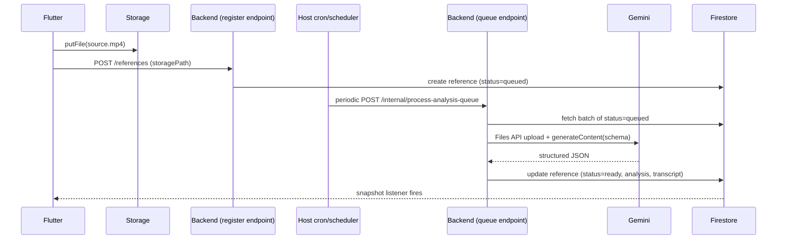

# Technical Deep Dive — Every Component, Every Flow, How The Code Is Actually Written

This doc exists so nobody has to guess how a layer is supposed to be coded. It traces real requests end to end, file by file, with representative code shapes (not full implementations — enough to copy the pattern exactly). Read [ARCHITECTURE.md](./ARCHITECTURE.md) first for the why; this is the how.

---

## 1. Frontend component map and what each layer is allowed to touch

```text
presentation/  (widgets)        -- reads controller, calls controller methods, never touches repository/ApiClient directly
      |
domain/        (controllers)    -- owns state, calls data layer, converts errors into UI-safe states
      |
data/          (repository)     -- calls core/network/ApiClient or Firebase SDKs directly, maps raw JSON -> models
      |
core/network/  (ApiClient)      -- one Dio instance, interceptors, base URL, auth header injection
```

A widget that imports anything from `data/` or `core/network` directly is a bug. A controller that imports a Flutter widget is a bug. This is enforced by convention, not tooling, in v1 — if the project later wants it enforced mechanically, add `package:custom_lint` rules or an import-boundary lint; not needed yet.

### 1.1 Dependency wiring (`frontend/lib/app/bootstrap.dart`)

Everything is wired once, at startup, and handed down via `Provider` — no service locator, no global singletons reached for directly by widgets.

```dart
// frontend/lib/app/bootstrap.dart
Future<Widget> bootstrap() async {
  await Firebase.initializeApp(options: DefaultFirebaseOptions.currentPlatform);

  final apiClient = ApiClient(baseUrl: Env.apiBaseUrl);
  final secureStorage = SecureStorageService();
  final authRepository = AuthRepository(firebaseAuth: FirebaseAuth.instance);
  final referencesRepository = ReferencesRepository(
    firestore: FirebaseFirestore.instance,
    storage: FirebaseStorage.instance,
    apiClient: apiClient,
  );

  return MultiProvider(
    providers: [
      Provider.value(value: apiClient),
      ChangeNotifierProvider(create: (_) => AuthController(authRepository)),
      ChangeNotifierProvider(create: (_) => WorkspaceController(workspaceRepository)),
      // one ChangeNotifierProvider per feature controller that needs app-wide lifetime;
      // screen-scoped controllers (e.g. a single script's WritingRoomController) are
      // provided lower in the tree, at the route that needs them, not here.
    ],
    child: const FoolscapApp(),
  );
}
```

Rule: **app-wide** controllers (auth, current workspace) live in the root `MultiProvider`. **Screen-scoped** controllers (a specific script being edited, a specific reference being viewed) are provided at the route/page level via `ChangeNotifierProvider` wrapping just that page, so their lifetime matches the screen, not the whole app. This is the concrete form of playbook rule "keep state close to where it is needed, but not inside every leaf widget."

### 1.2 The ApiClient (`frontend/lib/core/network/api_client.dart`)

One Dio instance for the entire app. Every backend-bound repository call goes through this — never `Dio()` constructed ad hoc inside a repository.

```dart
class ApiClient {
  ApiClient({required String baseUrl}) : _dio = Dio(BaseOptions(baseUrl: baseUrl)) {
    _dio.interceptors.add(InterceptorsWrapper(
      onRequest: (options, handler) async {
        final token = await FirebaseAuth.instance.currentUser?.getIdToken();
        if (token != null) options.headers['Authorization'] = 'Bearer $token';
        handler.next(options);
      },
      onError: (error, handler) => handler.next(_mapDioError(error)),
    ));
  }

  final Dio _dio;

  Future<Response<T>> get<T>(String path, {Map<String, dynamic>? query}) =>
      _dio.get<T>(path, queryParameters: query);
  // post/patch/delete follow the same shape
}
```

`_mapDioError` converts transport/HTTP errors into the app's own `NetworkException` hierarchy (`core/errors/network_exceptions.dart`) — `UnauthorizedException`, `ValidationException(fieldErrors)`, `ServerException`, `TimeoutException` — so every repository and controller deals with one typed error vocabulary instead of raw Dio exceptions. This mirrors the backend's single error envelope (section 3 below) on purpose: one envelope shape, one exception hierarchy, no translation guesswork in between.

### 1.3 Repository pattern (`frontend/lib/features/library/data/references_repository.dart`)

A repository is the **only** place that talks to Firestore/Storage/ApiClient for its feature. It returns typed models, never raw maps, and never leaks `DocumentSnapshot` or `Response` out of itself.

```dart
class ReferencesRepository {
  ReferencesRepository({required this.firestore, required this.storage, required this.apiClient});
  final FirebaseFirestore firestore;
  final FirebaseStorage storage;
  final ApiClient apiClient;

  Stream<List<ReferenceModel>> watchReferences(String workspaceId, {String? folderId}) {
    var query = firestore.collection('workspaces/$workspaceId/references')
        .where('deletedAt', isNull: true)
        .orderBy('createdAt', descending: true);
    if (folderId != null) query = query.where('folderIds', arrayContains: folderId);
    return query.snapshots().map(
      (snap) => snap.docs.map((d) => ReferenceModel.fromJson(d.id, d.data())).toList(),
    );
  }

  Future<String> uploadReferenceVideo(String workspaceId, String referenceId, File file) async {
    final ref = storage.ref('workspaces/$workspaceId/references/$referenceId/source.mp4');
    final task = ref.putFile(file);
    // caller subscribes to task.snapshotEvents for progress; repository exposes the UploadTask,
    // controller translates it into loading-progress state, widget renders a progress bar.
    await task;
    return ref.getDownloadURL().then((v) => v);
  }
}
```

Note the Library feature reads Firestore **directly** (no backend round-trip for a live reference list) but the upload still goes to Storage directly too — the backend only gets involved once the client calls a plain "register this upload" endpoint after the file finishes writing (there's no GCP-native Storage trigger here, since there's no Cloud Functions — see section 3). Contrast with Pitch (section 5), where even reads go through the backend, because that data must be scoped to an unauthenticated token holder, not to "whatever this Firestore security rule allows the current user."

### 1.4 Controller pattern (`frontend/lib/features/library/domain/library_controller.dart`)

```dart
class LibraryController extends ChangeNotifier {
  LibraryController(this._repository, this.workspaceId) {
    _subscribe();
  }
  final ReferencesRepository _repository;
  final String workspaceId;

  List<ReferenceModel> _references = [];
  bool _isLoading = true;
  AppException? _error;

  List<ReferenceModel> get references => List.unmodifiable(_references);
  bool get isLoading => _isLoading;
  AppException? get error => _error;

  StreamSubscription? _sub;
  void _subscribe() {
    _sub = _repository.watchReferences(workspaceId).listen(
      (refs) { _references = refs; _isLoading = false; _error = null; notifyListeners(); },
      onError: (e) { _error = AppException.from(e); _isLoading = false; notifyListeners(); },
    );
  }

  @override
  void dispose() { _sub?.cancel(); super.dispose(); }
}
```

Widgets only ever read `controller.references`, `controller.isLoading`, `controller.error` via `context.watch<LibraryController>()` and render exactly one of: loading view, error view, empty view, or the list — per playbook section 4/15/21's mandatory states. No widget calls `_repository` or Firestore directly, ever.

### 1.5 Navigation (`frontend/lib/core/routing/app_router.dart`)

`go_router` with a `StatefulShellRoute` for the bottom/side nav shell (Library / Writing Room / Pitch tabs), auth guard via `redirect`:

```dart
final appRouter = GoRouter(
  refreshListenable: authController, // rebuilds redirect logic on sign-in/out
  redirect: (context, state) {
    final signedIn = authController.isSignedIn;
    final goingToAuth = state.matchedLocation.startsWith('/sign-in');
    if (!signedIn && !goingToAuth) return '/sign-in';
    if (signedIn && goingToAuth) return '/library';
    return null;
  },
  routes: [
    GoRoute(path: '/sign-in', builder: (_, __) => const SignInPage()),
    StatefulShellRoute.indexedStack(
      builder: (context, state, shell) => AppShell(navigationShell: shell),
      branches: [
        StatefulShellBranch(routes: [GoRoute(path: '/library', builder: (_, __) => const LibraryPage())]),
        StatefulShellBranch(routes: [GoRoute(path: '/room/:scriptId', builder: (_, s) => WritingRoomPage(scriptId: s.pathParameters['scriptId']!))]),
        StatefulShellBranch(routes: [GoRoute(path: '/pitches', builder: (_, __) => const PitchListPage())]),
      ],
    ),
  ],
);
```

Route paths live in `core/routing/route_paths.dart` as constants — no page ever hardcodes `'/room/...'` inline; see [NAVIGATION.md](./NAVIGATION.md) for the full table.

---

## 2. Backend component map and request lifecycle

```text
index.js                 -- app.listen(PORT) — the entire process entry point, no Cloud Functions
  -> src/app.js           -- Express instance: helmet, cors, json parser, route mount, error handler (last)
      -> src/routes/*      -- path + method + middleware chain + controller fn, nothing else
          -> src/middleware/*  -- auth, validate(schema), rateLimit
              -> src/controllers/*  -- req/res translation only: parse input, call service, shape response
                  -> src/services/*    -- business logic, orchestrates repositories, the ONLY layer allowed to call Gemini
                      -> src/repositories/*  -- Firestore/Storage calls only, no req/res knowledge
```

### 2.1 Entry point (`backend/index.js`)

```js
const app = require('./src/app');
const Env = require('./src/config/env');

app.listen(Env.port, () => console.log(`Foolscap backend listening on port ${Env.port}`));
```

That's the whole process — a single long-running Node server, same as any plain Express app. It's deployable to Render, Railway, Fly.io, Vercel's Node runtime, or a VPS; the host just needs to run `npm start` and route traffic to `Env.port`. There is no Cloud Functions, so there is also no GCP-native Storage trigger — see section 3 for how reference-upload processing works instead.

### 2.2 Express app assembly (`backend/src/app.js`)

```js
const express = require('express');
const helmet = require('helmet');
const cors = require('cors');
const { requestLogger } = require('./middleware/requestLogger.middleware');
const { errorHandler } = require('./middleware/errorHandler.middleware');
const routes = require('./routes');

const app = express();
app.use(helmet());
app.use(cors({ origin: Env.allowedOrigins }));
app.use(express.json({ limit: '2mb' }));
app.use(requestLogger);
app.use('/v1', routes);
app.use(errorHandler); // must be registered last
module.exports = app;
```

### 2.3 Route file (`backend/src/routes/references.routes.js`)

Routes are thin: path, method, middleware chain, controller — no logic.

```js
const router = require('express').Router();
const auth = require('../middleware/auth.middleware');
const validate = require('../middleware/validate.middleware');
const { updateTagsSchema } = require('../validators/references.validators');
const controller = require('../controllers/references.controller');

router.patch('/workspaces/:wid/references/:rid/tags', auth, validate(updateTagsSchema), controller.updateTags);
module.exports = router;
```

### 2.4 Middleware (`backend/src/middleware/auth.middleware.js`, `validate.middleware.js`)

```js
// auth.middleware.js
module.exports = async function auth(req, res, next) {
  const header = req.headers.authorization || '';
  const token = header.startsWith('Bearer ') ? header.slice(7) : null;
  if (!token) return next(new UnauthorizedError('Missing token'));
  try {
    const decoded = await admin.auth().verifyIdToken(token);
    req.uid = decoded.uid;
    next();
  } catch (e) {
    next(new UnauthorizedError('Invalid token'));
  }
};
```

```js
// validate.middleware.js — zod-based, one shape for every route
module.exports = (schema) => (req, res, next) => {
  const result = schema.safeParse({ body: req.body, params: req.params, query: req.query });
  if (!result.success) return next(new ValidationError(result.error.flatten()));
  req.validated = result.data;
  next();
};
```

### 2.5 Controller (`backend/src/controllers/references.controller.js`)

Controllers never touch Firestore and never contain business rules — they translate HTTP in, call exactly one service method, translate the result to the response envelope.

```js
exports.updateTags = async (req, res, next) => {
  try {
    const { wid, rid } = req.validated.params;
    const { tags } = req.validated.body;
    const updated = await referencesService.updateTags({ workspaceId: wid, referenceId: rid, uid: req.uid, tags });
    res.json({ ok: true, data: updated });
  } catch (e) { next(e); }
};
```

### 2.6 Service (`backend/src/services/references.service.js`)

Business logic, permission checks beyond raw auth (e.g. "is this uid actually a member of this workspace"), orchestration across repositories.

```js
exports.updateTags = async ({ workspaceId, referenceId, uid, tags }) => {
  await workspacesRepository.assertMember(workspaceId, uid); // throws ForbiddenError if not a member
  return referencesRepository.updateTags(workspaceId, referenceId, tags);
};
```

### 2.7 Repository (`backend/src/repositories/references.repository.js`)

Only layer that imports `firebase-admin`'s Firestore/Storage clients.

```js
exports.updateTags = async (workspaceId, referenceId, tags) => {
  const ref = db.doc(`workspaces/${workspaceId}/references/${referenceId}`);
  await ref.update({ tags, updatedAt: FieldValue.serverTimestamp() });
  return (await ref.get()).data();
};
```

### 2.8 Error handling, end to end

One envelope shape, defined once (`backend/src/utils/responseEnvelope.js` + custom error classes in `backend/src/utils/errors.js`):

```js
// success: { ok: true, data: ... }
// failure: { ok: false, error: { code: "VALIDATION_ERROR", message: "...", details?: {...} } }
```

```js
// errorHandler.middleware.js
module.exports = (err, req, res, next) => {
  const status = err.statusCode || 500;
  logger.error({ reqId: req.id, status, code: err.code, message: err.message });
  res.status(status).json({
    ok: false,
    error: { code: err.code || 'INTERNAL_ERROR', message: status === 500 ? 'Something went wrong' : err.message, details: err.details },
  });
};
```

On the Flutter side, `ApiClient`'s `onError` interceptor reads exactly this shape and raises the matching `AppException` subtype (section 1.2) — the envelope and the client-side exception hierarchy are two halves of one contract, kept in sync manually since there's no shared-codegen layer yet (see [ASSUMPTIONS_AND_DECISIONS.md](./ASSUMPTIONS_AND_DECISIONS.md) on whether to add OpenAPI/codegen later).

---

## 3. The one genuinely async pipeline: reference upload -> analysis -> ready

This is the most complex flow in the app, and the one most reshaped by running on a plain Node host instead of Cloud Functions: there's no GCP-native Storage trigger and no Cloud Tasks queue available, so the design is **client-registers, server-polls** instead of **event-triggered**. Steps 1-2 below (registering the upload) are settled; step 3 (how the queue gets processed) describes the leading option — a cron-hit endpoint — but that choice is deliberately still open until the backend host is picked (see [ASSUMPTIONS_AND_DECISIONS.md](./ASSUMPTIONS_AND_DECISIONS.md)); a long-running polling worker is the alternative if the host supports a persistent process. Full trace of the cron-hit version:

1. **Flutter** uploads `source.mp4` directly to Cloud Storage (section 1.3). The client's local UI shows an optimistic "uploading" placeholder keyed by a client-generated temp ID — no Firestore doc exists yet, so a failed upload just means the placeholder quietly goes away, never a half-written doc with no file.
2. Once the upload finishes, **Flutter calls a plain backend endpoint** to register it:
   ```js
   // routes/references.routes.js
   router.post('/workspaces/:wid/references', auth, validate(createReferenceSchema), controller.create);
   ```
   The controller/service/repository chain creates `references/{rid}` with `status: "queued"` and the known `storagePath` — ordinary request/response, no special infra.
3. A small **internal endpoint**, not exposed to the Flutter app, processes the queue:
   ```js
   // routes/internal.routes.js — protected by a shared secret header, not Firebase auth
   router.post('/internal/process-analysis-queue', requireInternalSecret, controller.processQueue);
   ```
   This endpoint is hit **periodically by whichever scheduling feature the backend host provides** (a cron job on Render/Railway, a scheduled GitHub Action, Vercel Cron, etc. — whatever's free and available; this is a deploy-time choice, not an architectural one). Each invocation: queries Firestore for a small batch of `status: "queued"` references, flips each to `"analyzing"`, and calls the one Gemini call site for each:
   ```js
   // services/geminiAnalysis.service.js
   exports.analyzeReference = async ({ workspaceId, referenceId, storagePath }) => {
     const fileUri = await geminiFilesClient.upload(storagePath); // Files API, server-side only
     const result = await geminiClient.generateContent({
       model: 'gemini-2.5-flash',
       contents: [{ role: 'user', parts: [{ fileData: { fileUri } }, { text: ANALYSIS_PROMPT }] }],
       generationConfig: { responseMimeType: 'application/json', responseSchema: REFERENCE_ANALYSIS_SCHEMA },
     });
     return REFERENCE_ANALYSIS_SCHEMA.parse(JSON.parse(result.text)); // zod-validated even though schema-constrained — never trust blindly
   };
   ```
   `REFERENCE_ANALYSIS_SCHEMA` is a zod schema whose shape is the enum/number/timestamp-only contract from [FIRESTORE_SCHEMA.md](./FIRESTORE_SCHEMA.md) `analysis` map — this schema is passed to Gemini *and* used to validate the response, so the AI firewall's "no field that can hold a generated script" rule is enforced in two places, not just hoped for.
4. On success: `referencesRepository.update(... { analysis, transcript, onScreenText, status: 'ready' })`. On failure: `status: 'failed'`, `failureReason` set — there's no automatic retry-with-backoff the way Cloud Tasks gave for free, so build a simple retry count into the queue query (e.g. only pick up `status: "queued"` or `status: "failed", retryCount < 3`) if that matters once this is actually built.
5. **Flutter** has been subscribed to the `references/{rid}` snapshot stream the entire time (section 1.4) — no polling on the client side, no manual refresh. The `status` field transitions drive the UI state machine directly. The *only* polling in this system is the host's scheduler hitting the internal endpoint — the client never polls anything.

**Why not just process it inline in step 2's request handler?** Gemini analysis of a multi-minute video can take long enough that most free-tier Node hosts' request timeouts (and definitely serverless-style hosts like Vercel) would kill it mid-flight. Decoupling "register the upload" from "do the analysis" into two separate, independently-timed operations is what makes this portable across hosts with very different execution-time limits, instead of betting the whole feature on one host's generous timeout.



---

## 4. Security rules trace: who writes what, and why

| Collection | Client direct write? | Why |
|---|---|---|
| `references/{rid}` core fields (`tags`, `folderIds`) | Yes, via rules checking workspace membership | Low-risk, user-owned organizational metadata |
| `references/{rid}.analysis`, `.transcript`, `.status` | **No** — backend only (set via the register-upload and queue-processing endpoints, section 3) | Must stay machine-authored; a client write path here would let a user fabricate "AI said this was a 95 outlier score" |
| `scripts/{sid}/versions/{vid}` | **No** — backend only | `authorUid`/`createdAt` must be server-stamped for Human Ink to mean anything |
| `pitches/{pid}/comments/{cid}` | Via backend public-token endpoint only, never direct Firestore rule for unauthenticated writes | Keeps the one unauthenticated write surface rate-limited and validated in one place instead of relying on a security rule to safely gate anonymous writes |
| `workspaces/{wid}.members` | **No** — backend only | Role elevation must go through a service that checks the actor's own role first |

Firestore security rules (`firestore.rules`) enforce the read side and the allowed client-direct-write fields; everything marked "backend only" above is additionally enforced by simply never exposing a client-writable rule for those fields — the absence of a permissive rule *is* the control, reinforced by `firebase-admin` on the backend bypassing rules entirely (admin SDK always can, so the discipline is procedural: backend code must never write a machine-authored field from client-supplied input without revalidating it itself).

---

## 5. Pitch's different shape: backend-mediated reads, and no Flutter involved at all

Every other feature's Flutter code reads Firestore directly through a repository (section 1.3). Pitch's public surface is the one exception, for two compounding reasons: its reader (the client/brand) has no Firebase Auth identity, *and* Foolscap ships Android/iOS only — there is no guarantee that reader has the app installed at all. So this surface isn't "a Flutter screen with no login," it's not a Flutter screen, period.

```js
// routes/pitches.routes.js — JSON API, public, no auth middleware, but rate-limited
router.get('/pitches/by-token/:token', rateLimit({ windowMs: 60_000, max: 30 }), controller.getByToken);
router.post('/pitches/by-token/:token/comments', rateLimit({ windowMs: 60_000, max: 10 }), validate(addCommentSchema), controller.addComment);

// routes/pitchPage.routes.js — mounted at root, NOT under /v1 — returns HTML, not JSON
router.get('/pitch/:token', rateLimit({ windowMs: 60_000, max: 30 }), pitchPageController.render);
```

The JSON controller resolves `shareToken -> pid` once, loads exactly that pitch's pinned script version and reference list, and returns a flattened, purpose-built payload — never a generic "query Firestore with this token as a filter" passthrough, which would risk over-fetching or leaking sibling data if the query shape ever changed. The HTML controller (`pitchPage.controller.js`) calls the same service the JSON controller does and renders a minimal server-side template (plain template literals or a tiny template engine — no SPA framework, no build step) so a client on any phone, with or without Foolscap installed, can open the link and see the script, references, and shot list, and leave a comment, directly from a mobile browser.

This is the concrete reason Pitch gets its own backend route group instead of following every other feature's direct-Firestore-read pattern — and the concrete reason the "mobile-only" rule in [ARCHITECTURE.md](./ARCHITECTURE.md) section 6 didn't require adding a Flutter Web build: the one surface that looked like it needed a browser target was never going to be a Flutter screen anyway, because the person opening it was never going to be a Foolscap user.

---

## 6. Naming and file conventions (both stacks)

| Layer | File suffix | Example |
|---|---|---|
| Flutter model | `*_model.dart` | `reference_model.dart` |
| Flutter repository | `*_repository.dart` | `references_repository.dart` |
| Flutter controller | `*_controller.dart` | `library_controller.dart` |
| Flutter page | `*_page.dart` | `library_page.dart` |
| Flutter reusable widget | `*_view.dart` or plain name | `reference_card.dart` |
| Backend route group | `*.routes.js` | `references.routes.js` |
| Backend controller | `*.controller.js` | `references.controller.js` |
| Backend service | `*.service.js` | `references.service.js` |
| Backend repository | `*.repository.js` | `references.repository.js` |
| Backend validator | `*.validators.js` | `references.validators.js` |
| Backend trigger (non-HTTP) | lives in `src/triggers/`, named for the event | `onReferenceUploaded.js` |

One feature name is used consistently across both stacks (`references`, `scripts`, `pitches`, `workspaces`) so grepping one word finds the whole vertical slice on either side of the wire.
